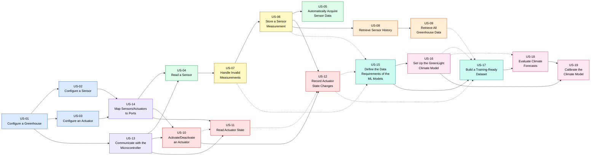

# User Story Dependencies — Sprint 1

Sprint 1 runs from **25 November 2026** to **22 December 2026** (four weeks).

An arrow `A → B` means **B depends on A**: A must be done (or at least its interface agreed) before B can be completed.
Solid arrows are hard dependencies; dashed arrows are soft ones (B is more useful with A, but can be built without it).
Transitive hard edges are omitted (e.g. US-04 depends on US-01 through US-02).

Colours: blue = Epic 1 Configuration · purple = Epic 6 Microcontroller · green = Epic 2 Acquisition · yellow = Epic 3 Dataset · orange = Epic 4 Retrieval · red = Epic 5 Actuators · teal = Epic 7 ML Data Pipeline · pink = Epic 8 Greenhouse Climate Model.

## Dependencies and rationale

| Story | Depends on | Why |
|---|---|---|
| US-01 | — | Root: every other entity belongs to a greenhouse. |
| US-02 | US-01 | A sensor is associated with a greenhouse. |
| US-03 | US-01 | An actuator is associated with a greenhouse. |
| US-13 | US-01 | The link is per-greenhouse microcontroller; it does not need the port mapping to open a connection, send raw commands or report its status. |
| US-14 | US-02, US-03 | Ports are mapped onto already-registered sensors and actuators. |
| US-04 | US-13, US-14 | Reading a sensor needs its port and a working link. |
| US-07 | US-04 | Validation applies to the readings produced by US-04. |
| US-06 | US-07 | Only *valid* readings are stored, so validity must be decidable. |
| US-05 | US-06 | Periodic acquisition reads (US-04), filters (US-07) and stores (US-06) every sensor. |
| US-10 | US-13, US-14 | A command is sent to the actuator's port over the link. |
| US-11 | US-13, US-14 (soft: US-10) | Reading the state needs only port + link; it becomes meaningful for verifying commands once US-10 exists. |
| US-12 | US-10, US-06 (soft: US-11) | State changes come from US-10 and are written to the same dataset as US-06; US-11 lets the record reflect the state actually detected. |
| US-08 | US-06 | History can only be retrieved once measurements are stored. |
| US-09 | US-08 | Multi-sensor retrieval generalises single-sensor retrieval. |
| US-15 | soft: US-06, US-07, US-12 | The ML data requirements must match the measurement record, the way invalid readings are marked, and the actuator event record. Only the formats are needed, not working code. |
| US-16 | US-15 | The simulation output must follow the agreed data format. |
| US-17 | US-15 (soft: US-16, US-09, US-12) | The pipeline reads the agreed format. It is first built on simulated data (US-16) and later fed with real data through US-09 and the actuator events of US-12. |
| US-18 | US-17 (soft: US-16) | Forecasts are evaluated on the test period of the prepared dataset; the GreenLight model is the first model to evaluate. |
| US-19 | US-16, US-18 | Calibration adjusts the GreenLight parameters and is judged by the forecast error measured with US-18. |

## What the graph tells us

- **Critical path (8 stories):** US-01 → US-02 (or US-03) → US-14 → US-04 → US-07 → US-06 → US-08 → US-09. Any delay on these delays the whole backlog.
- **Work that can run in parallel:**

  | Step | Stories |
  |---|---|
  | 1 | US-01, US-15 |
  | 2 | US-02, US-03, US-13, US-16 |
  | 3 | US-14, US-17 |
  | 4 | US-04, US-10, US-11, US-18 |
  | 5 | US-07, US-19 |
  | 6 | US-06 |
  | 7 | US-05, US-08, US-12 |
  | 8 | US-09 |

- **The ML stories (US-15 to US-19) have only soft dependencies on the rest of the backlog.** They are developed on data simulated with GreenLight and switch to real data when the Digital Shadow (see the *Digital Twins for Greenhouses* architecture guide) has collected enough history.
- **Differences from the suggested order in `user_stories_sprint1.md`:**
  - US-13 does not need US-14, so it can start alongside US-02/US-03 instead of after the mapping.
  - The actuator branch (US-10, US-11) only needs US-13 and US-14, so it can be developed in parallel with the sensor branch rather than after US-05.
  - US-08 and US-09 depend only on storage (US-06) and can start before the actuator stories are finished.
- **Hub stories:** US-13, US-14 and US-06 each unblock three or more stories; their interfaces (communication API, port-mapping model, dataset record format) should be agreed early. US-06 and US-12 also define the record formats the ML models are trained on.

## Team assignment

Stories are grouped so that each team owns a connected part of the graph: 19 of the 32 dependencies stay inside one team. Of the 13 that cross team boundaries, the 5 that reach Team 5 are all soft.

The effort column uses rough story points (Fibonacci scale), only to balance the load; each team re-estimates its stories when it splits them into tasks.

| Team | Area | Stories | Effort |
|---|---|---|---|
| team-1 | Configuration | US-01 (3), US-02 (3), US-03 (3), US-14 (5) | 14 |
| team-2 | Microcontroller and sensor reading | US-13 (8), US-04 (5), US-07 (5) | 18 |
| team-3 | Dataset: storage, acquisition, retrieval | US-06 (5), US-05 (3), US-08 (5), US-09 (3) | 16 |
| team-4 | Actuator control | US-10 (5), US-11 (3), US-12 (3) | 11 |
| team-5 | AI: ML data pipeline and climate model | US-15 (2), US-16 (5), US-17 (5), US-18 (3), US-19 (5) | 20 |

The loads differ on purpose. Team 1, Team 2 and Team 5 can start on day one. Team 3 and Team 4 depend on other teams' work, so they get less or simpler work to make up for the waiting:

- **Team 3** can start US-06 on the agreed record format (the example record) before US-07 is finished.
- **Team 4** cannot test against hardware until US-13 and US-14 are done, so it has the smallest load.
- **Team 5** works only on AI and Machine Learning. Its load is the highest because it is never blocked; if it turns out to be too much, US-19 is the first story to move to the next sprint.

### Cross-team dependencies

| Provider | Story | Consumer | Story | Interface to agree early |
|---|---|---|---|---|
| team-1 | US-01 | team-2 | US-13 | Greenhouse identifier and model |
| team-1 | US-14 | team-2 | US-04 | Port-mapping lookup (component → port) |
| team-1 | US-14 | team-4 | US-10, US-11 | Port-mapping lookup (component → port) |
| team-2 | US-13 | team-4 | US-10, US-11 | Microcontroller communication API |
| team-2 | US-07 | team-3 | US-06 | Validated-reading object (valid / invalid + reason) |
| team-3 | US-06 | team-4 | US-12 | Dataset storage API and record format |
| team-3 | US-06 | team-5 | US-15 | Sensor measurement record format |
| team-2 | US-07 | team-5 | US-15 | How invalid and missing readings are marked |
| team-4 | US-12 | team-5 | US-15, US-17 | Actuator event record format |
| team-3 | US-09 | team-5 | US-17 | Retrieval API or export used to load training data |

Team 2, Team 3 and Team 4 review the ML data requirements written in US-15.
